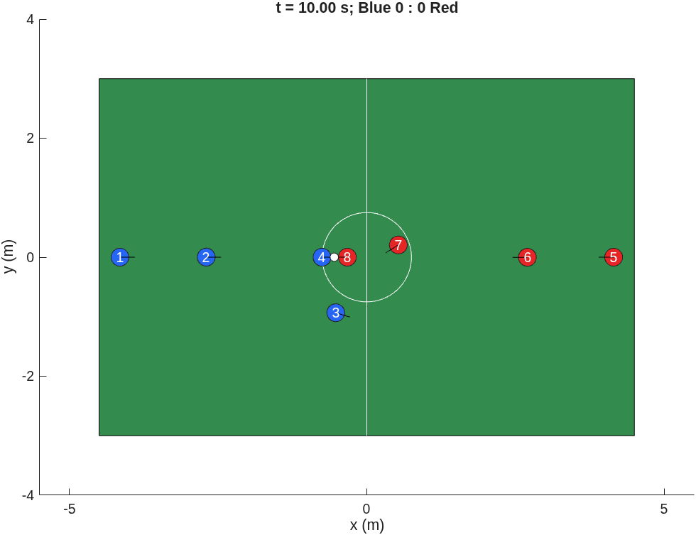
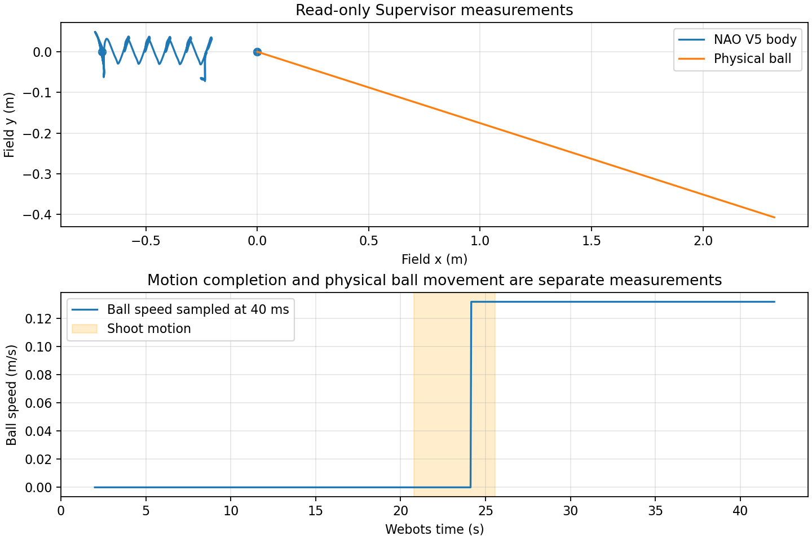
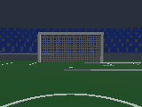

# TDP 足球迁移开发手册

TDP 是 Team Design Project（团队设计项目）。这份工程把 A 的 4v4、9×6 m 足球算法迁移到纯 MATLAB 算法库、每机器人独立的 Stateflow ControllerCore 和分离的二维环境中。它提供固定输入回放、动作编号/反馈/超时、规则配置、可再生模型及测试证据。**二维圆形代理不是已验证的 NAO6 动力学；Webots 参考机器人最高为 V5，不能把它的结果称为 NAO6 结果。**

读者只需已有 MATLAB/Simulink 基础。先运行下面的一键复现，再按“具体问题→原理与算例→源码→手动操作→预期现象与排错”的章节顺序学习。代码及注释为英文；概念说明为中文。所有“通过”以日志/回执为准，未执行的操作不会因文档写了步骤而变成通过。

要先看到比赛，请在本机文件管理器中打开工程目录，双击 **`START_2D.desktop`** 看球队 V1；另一个 **`START_2D_RECOVERY.desktop`** 会启动自动交还实验。使用 MATLAB 编辑器时也可以打开 `start_2d.m` 或 `start_2d_recovery.m` 后点绿色 **Run ▶**。首次启动的信任提示、冷启动等待与控件见 [README 图形启动说明](../README.md) 和[实时二维动画](chapters/live_animation.md)。

前锋恢复的三个条件属于小组选择的实验扩展。两种策略的参数、编号保护、故障场景与逐步日志见[自动交还实验](chapters/recovery_experiment.md)。

交付标签为 `baseline-v1`，二维冻结点为 `baseline-2d-v1`。最终干净 clone 的完整一键和可用手工路径均已通过；缺产品门仍为 BLOCKED，默认噪声轨迹分歧和未验证项见下表及[最终回执](../evidence/6/FINAL_RECEIPT.json)。该次冻结基线的运行代码验证目标为 `1f52c4c`。之后的动画与球队 V1 属独立增量。

现在直接执行 `./start_2d.sh` 会用球队 V1 的四个固定角色开赛。每队获得追球授权的机器人有金色外圈。要在独立 MATLAB 进程复现二维战术验收，在工程根目录运行 `./scripts/run_matlab.sh "tdpSetup; reproduce_v1;"`。它从空白建模，执行定向场景，再以 20 个种子分别在 50 ms 和 40 ms 下跑满 600 s。模型接线、教学假设和每项判据见[战术开发章节](chapters/tactics_v1_design.md)。

初次上手建议先跑十秒。要看到动画，在桌面终端执行 `TDP_2D_DURATION=10 ./start_2d.sh`。只想得到物理与战术矩阵，可按[十秒无图形实验](chapters/tactics_v1_design.md#无窗口运行十秒并找到日志)运行并加载 MAT 文件。要复验当前球队策略，使用 `reproduce_v1`；课题各阶段连同 ROS 和 Webots 的综合复现入口为 `reproduce_all`。

最终可执行提交 `a324545` 含暂停确认修复。在另一份新克隆中再次运行同样的种子和控制周期，每一场的物理和战术记录均与原正式矩阵逐元素相同。[交付版逐场核查](../evidence/tactics-v1/release-matrix-01/receipt.json)

另一位首次阅读手册的验证者在新克隆中照做了十秒实验。两次启动得到完全相同的物理和战术数组，并用已保存的逐场数据重算出相同的 40 场汇总。实际终端输出和日志读法见[独立读者记录](../evidence/tactics-v1/reader-01/README.md)。

## 1. 当前交付层级

| 项目 | 实际达到的层级 | 证据 / 限制 |
|---|---|---|
| 自动交还二维实验（单独入口） | 新克隆重建，默认 V1 对照及自动交还整场运行通过；两个图标对应的真实窗口通过 | [逐场对照与完整回放](generated/recovery_results.md) · [交还与取消练习](chapters/recovery_experiment.md) · [实验验收回执](../evidence/recovery-v1/FINAL_RECEIPT.json) |
| 球队 V1 二维增量 | 全新克隆重建，25 项定向测试、40 场各 600 s、两个周期的完整重复回放通过 | [球队 V1 整场结果](generated/v1_results.md) · [逐场回执及指标](../evidence/tactics-v1/matrix-final-01/summary/receipt.json) · [首次阅读与操作](chapters/tactics_v1_design.md) |
| 阶段 0 原始基线 | 80 场 × 600 s；20 种种子 × 两种噪声 × 两次完全相同 | `evidence/0/FINAL_RECEIPT_v2.json`；首步与 90 步滚动校核通过 |
| 阶段 1 算法迁移 | 11 个入口各 ≥1000 组；误差 ≤1e-12；screener 零阻塞诊断 | `evidence/1/FINAL_RECEIPT.json`；coder.screener 是代码生成兼容性的静态检查；实际模型编译仍另行验收 |
| 阶段 2 单机 | 实际 Stateflow、延迟执行层、反馈、超时、失败/拒绝、失球/停赛、去重和迟到反馈；两个周期闭环 | `evidence/2/FINAL_RECEIPT.json` |
| 阶段 3 两队 | 8 个 Core、2 个协调器；40 场完整对照；0.05/0.04 s 长跑 | `evidence/3/FINAL_RECEIPT.json`；默认噪声轨迹有分歧，指标一致，见下文 |
| 行为修复 | 接触迭代、同心分离、可选规则、清晰统计含义；先复现再独立提交 | `evidence/3/repairs-02/`；ACompat 仍保留旧行为以便对照 |
| 教学扩展 | 阈值、角色、有限视野、观测延迟/噪声、Tap；两个手搭小模型 | `evidence/6/teaching-02/receipt.json` |
| 阶段 4 MATLAB 在线 ROS 2 / 独立生成节点 | **BLOCKED**：ROS Toolbox、Simulink Coder、MATLAB Coder 未安装，且本任务禁止安装 | 许可测试为 1 不等于产品已安装；不得用 Python 测试冒充这些验收门 |
| 阶段 4 CLI / 代理在线 | 标量回环、101帧原Core在线/离线动作完全一致；年龄适配与变异通过 | `evidence/4/FINAL_RECEIPT.json`；[ROS章节](chapters/ros2.md)，不是原生ROS Toolbox验证 |
| 阶段 5 Webots | 单NAO V5闭环接近/物理踢球；1001帧回放一致；去重/唯一clock/真实相机通过 | `evidence/5/FINAL_RECEIPT.json`；[Webots章节](chapters/webots.md)。原生Read Image仍BLOCKED，动力学未实机验证 |
| 阶段 6 手册 | 最终 M2 干净 clone 一键、API 手搭、CLI/代理和 Webots 可用手工路径通过；14 组输入哈希一致 | `evidence/6/clean-final-03/final-manual/independent-audit-03/FINAL_AUDIT.json`；GUI 拖拽未自动验收 |

严格区分三个结论：通信成功只证明数据传到了；动作执行成功只证明执行层按协议结束；模型得到验证还需要与真实机器人/实测数据比较。当前没有 NAO6 实机标定证据。

兼容性结果：零噪声 20 场最大逐元素差异约 5.153e-14，在 1e-12 门限内；默认噪声 20 场最大差异约 0.0246225，不能称为轨迹等价。40 场的进球、射门和首次触球都相同。第一处分歧、原因判断及影响见 [逐场对照](COMPAT_COMPARISON.md)。修复后种子 13 的 600 s 长跑：50 ms 完全受阻请求约 0.068%，40 ms 为 0；两者机器人重叠和越外缓冲边界均为 0。越比赛区边线的采样仍存在，不能把“未越缓冲边界”写成“始终在比赛区”。

## 2. 一键复现

本机工程根目录是：

```text
/home/fayne/Documents/Robotics & AI/Robotics TDP/2d-soccer-game/tdp-migrated-r1
```

需要现成 MATLAB R2026b、Simulink、Stateflow；本机还有 Robotics System、Navigation、Image Processing。Python 3.12 和系统已有的 NumPy/SciPy/Matplotlib 用于证据与图片；不改系统 Python，不安装产品。自动流程用独立 `matlab -batch`，不连接已打开的 MATLAB，不弹出模型或绘图窗口。

```bash
cd '/home/fayne/Documents/Robotics & AI/Robotics TDP/2d-soccer-game/tdp-migrated-r1'
./scripts/run_matlab.sh "tdpSetup; reproduce_all;"
```

脚本会从空白重建全部新模型，生成手册数字/图片，运行完整基线、算法等价、Stateflow/比赛/修复/教学测试，再检查各套件已有的有效变异回执，随后运行完整M2标准ROS/单动作/Webots闭环、实际相机与回放。不是只跑几秒的快速演示。输出位于新建的 `build/reproduce-时间戳/`；最后一行给出 receipt.json 的绝对路径与实际耗时。**当前M2预期总状态为 `PASS_AVAILABLE_M2_WITH_BLOCKERS_AND_NOISY_TRACE_DIFFERENCES`；二维标签的状态为 `PASS_2D_WITH_DOCUMENTED_NOISY_TRACE_DIFFERENCES`。依赖缺失项仍为 BLOCKED。** 最终独立干净 clone（代码 `1f52c4c`）完整 M2 流程内部耗时 2375.581 s，包含启动等开销的墙钟时间为 2429.332 s（约 40.5 分钟）；其中 M2 内部耗时 350.657 s。证据见 `evidence/6/clean-final-03/command.json` 与 `artifacts/receipt.json`。手工 API 路径用 181.211 s；包含它在内的 12 条成功手工命令耗时累计 638.053 s（约 10.6 分钟），不含阅读、暂停和被中断尝试；逐项命令及耗时见 `evidence/6/clean-final-03/COLLECTION_INDEX.json`。GUI 拖拽本身未自动验收。机器负载和编译缓存会影响耗时；本次前段曾与独立 M2 回归并行。这些是实测耗时，不是下一次运行必须满足的断言。二维标签的历史复现见 `evidence/6/clean-room-01/FINAL_AUDIT.json`。

`run_matlab.sh` 默认 MATLAB 安装路径为 `/home/fayne/Applications/MATLAB/R2026b/bin/matlab`。其他电脑先把脚本中的可执行路径改为自己的安装位置，并记录 MATLAB 版本；不要修改源算法来迁就结果。脚本清除终端继承的 ROS 动态库路径和 DISPLAY，使用 `build/matlab-prefs`；`tdpSetup` 将缓存/生成代码放到 build。不会 savepath 或改用户偏好。

需要先看一个具体数值时：

```bash
./scripts/run_matlab.sh "tdpSetup; a=runA(1,0,0.05);disp(a.trace(1,76));disp(a.robots(4).x);"
```

预期值与完整周期表由程序生成，见 [数字算例](generated/manual_numbers.md)。首步为什么得到这些数：前锋距球后接近点 0.55 m，比例增益 0.8 给出请求；执行侧再限速和积分。球模型先减速再积分，因此离散停止距离与连续时间公式不同。若不符，先查运行目录、`which runA -all`、P.dt、随机种子、噪声与轨迹列定义，不要改 reference 原文件。

## 3. 阅读和动手顺序

1. [架构与一个时间步](chapters/architecture.md)：谁保存状态、谁能写球速、Unit Delay 在哪里。
2. [接口契约](chapters/interfaces.md)：坐标、单位、有效性、采集时刻、全部总线/枚举；自动字段表见 [interfaces](generated/interfaces.md)。
3. [模块卡片](chapters/modules.md)：每个模块的任务、A/B 对应源码、数字算例、输入输出、测试、改动方法和限制。
4. [Stateflow 详解](chapters/stateflow.md)：完整状态文字与优先级来自 [生成表](generated/stateflow.md)，实际周期来自 [回放表](generated/manual_numbers.md)。
5. [七条手工复现路径](chapters/handson.md)：函数与测试→闭环延迟→平铺图→层级 Kick/Recover→回放→ROS→Webots。
6. [测试手册](chapters/testing.md) 和 [已做过的扩展示例](chapters/extensions.md)。
7. [原问题与修复边界](chapters/defects.md)、[参数表](generated/parameters.md)、[决策记录](DECISIONS.md)、[真实排错记录](chapters/troubleshooting.md)。
8. [ROS 2标准消息与在线适配](chapters/ros2.md)、[Webots场景/相机/单动作/物理闭环](chapters/webots.md)、[M2实测数字](generated/m2_numbers.md)、[三维参数及假设](generated/webots_parameters.md)。
9. [课程对应与导师问题](chapters/course_mapping.md)、[AI 声明](AI_PROVENANCE.md)。



模型的权威来源是 `scripts/build_*.m`。基线之后，改模型应改脚本、重建、测试，并把脚本和生成 SLX 一起提交。`robot-soccer-starter/` 是原仓库历史参考，里面的 SLX 不属于这套新生成模型，不拿它们作为本项目可再生模型的输出。

## 4. 干净 clone：按这份手册独立复现

在本分支的 `2d-soccer-game/` 项目目录打开终端。以下命令从上一级本地仓库克隆 `fayne-bahaviours-tactics` 分支，在独立副本中复现。请使用尚不存在的目标目录。

```bash
mkdir -p build
git clone --no-hardlinks --single-branch --branch fayne-bahaviours-tactics .. build/clean-room-final
cd build/clean-room-final/2d-soccer-game
./scripts/run_matlab.sh "tdpSetup; reproduce_all;"
```

随后只按照 [手工路径](chapters/handson.md) 操作；无图形自动验收可运行其等价入口 `build_lessons`、`test_lessons`、`test_controller`，并阅读完整状态文字和接线表。GUI 拖放本身仍是组员练习，不把自动生成图冒充人手拖拽。ROS/Webots路径按新增章节实际运行；原生ROS Toolbox、Read Image及生成节点因产品未装记录BLOCKED。每次命令使用新输出目录；不得启动第二个回放clock源去同时驱动Webots。

记录 clone 的 `git rev-parse HEAD`、MATLAB 版本、开始/结束时间、完整 receipt 路径、遇到的手册缺口。干净复现发现的问题须修正文档或代码后再用新 clone 验证；不要悄悄依赖原 worktree 的 build 缓存。开工与完工清单分别为 `evidence/0/inputs-before.json`、`evidence/6/inputs-after.json`。14 组只读输入、818 个文件的相对路径及 SHA-256 全部一致；比较日志为 `evidence/6/input-hash-comparison.log`。

进度和续接入口：[PROGRESS.md](PROGRESS.md)。只读输入的来源快照在 reference；详细哈希在 evidence。大轨迹留在 build，提交证据保留 SHA-256，不把“文件存在”当作测试通过。

实际V5闭环轨迹与相机（均由脚本生成）：





## 5. 这次干净复现实际修正了什么

独立读者从手册入口开始，在全新 clone、全新 MATLAB 进程和空运行缓存中执行完整流程。早期复现发现验收回执可能在失败前先写 PASS，及真值隔离测试缺少阳性对照；对应独立修复、原始失败和有效变异均保留。随后完整 clone 暴露相机首帧早于 DDS 发现的启动竞态；修复为冻结仿真时重发同一 stamp 的首帧，新的完整 clone 再次从头执行成功。详细原因见排错章节。

最终一键与手工 Webots 的轨迹哈希相同，手工实测的 22 项生成数字逐项精确相同。中途用户暂停和进程消失的 ROS 手工尝试不计通过；新的成功尝试另存。历史失败、暂停、接续记录均在 evidence/6，不能以最终成功覆盖它们。所有 task 实验进程及端口已清理；与用户原 MATLAB 桌面可能共享的 MathWorks 辅助服务保留，未操作用户桌面。
