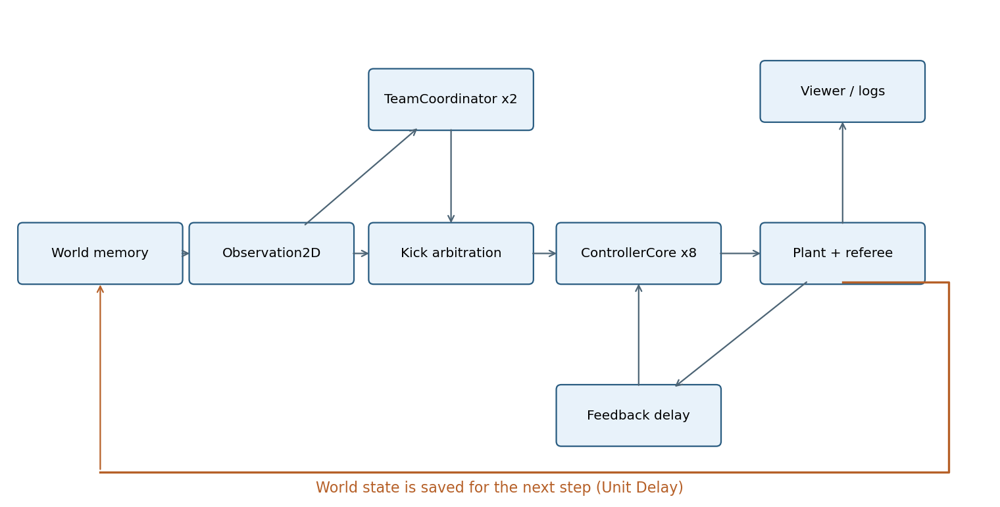

# 从一次传球看懂架构

## 问题：为什么不能把 A 的主循环直接塞进状态图？

A 在同一段循环中决定目标、修改球速、移动机器人、处理碰撞、更新比分。这样可以快速演示，但无法回答“请求发出去以后，到底执行完了没有”。Webots 的脚必须真的碰到球，控制器不能靠写球速完成任务。本工程把意图、执行和物理状态分开。

算法是无记忆的数值函数：同样输入得到同样输出，不画图、不读基础工作区。Stateflow 是带记忆的状态机：它记住当前阶段、正在等待的请求编号及进入阶段的时间。Simulink 总线是有字段名、类型和尺寸的信号集合，可理解为在线路上传递的固定结构体。Unit Delay（单位延迟）保存上一次采样的值，让反馈从下一拍才返回，避免“当前输出又需要当前输出”的代数环。

`ControllerCore` 库复用代码，每个实例仍有独立状态，机器人 1 的 Kick 不会使机器人 2 进入 Kick。本版本显式摆放八个实例，便于初学者跟踪端口；B 的 For Each 子系统展示了另一种重复执行结构，本版本不依赖 B 的行为或尺度。

## 一个时间步的精确顺序

设控制周期 dt=0.05 s，仿真步号 k 从 1 开始，输入时间 tSim=k×dt。Simulink 的 Digital Clock 首个采样是 0，因此比赛模型的 StepTime 显式算 `round(clock/dt+1)*dt`。时间不来自电脑速度、`tic/toc` 或墙上时钟。

1. WorldMemory 输出上拍结束后的机器人、球和裁判状态。Observation2D 创建带有效性和采集时刻的观测。采集时刻是上一拍状态时刻；控制调用时刻是当前 tSim，这两个量不能混用。
2. 蓝、红 TeamCoordinator 分别用一份团队观测和自己的上拍前锋编号算四个角色与意图。角色分配来自 A；只有前锋记忆跨拍保存。
3. 二维仲裁器按奇数步 1→2、偶数步 2→1 的队序，队内按编号检查是否已有人满足踢球条件。后续人的 allowKick 为 false。此处是 A 的二维执行约束，不是通用三维规则。
4. 八个 Core 只读取观测、团队意图、上拍反馈和 tSim。Geometry 算几何量；Stateflow 决定技能阶段；EmitRequest 组装请求。
5. Plant2D 按同一队序调用 Actuator2D。只有环境侧能够设置二维球速。噪声样本也在环境侧生成；未踢出时不消耗随机样本。
6. 调用 robotModel 限速和积分，然后 ballModel 减速、积分，再碰撞、最后触球时间统计和裁判。进球重置、暂停等属于裁判状态。
7. 保存当步 98 列记录，再把物理状态与反馈送入各自的 Unit Delay。显示读取日志，不参与闭环。

这保留了 A 的“先限速、后积分”“球先减速、后走位”“奇偶队序”“每步最多一踢”。ACompat 中暂停仅冻结球与踢球，机器人仍可调整位置；这是被保留的现有行为，不能误写成已实现完整停赛规则。

## 谁拥有状态

| 所有者 | 保存什么 | 谁可读写 |
|---|---|---|
| WorldMemory / 环境 | 8 个机器人真值、球、裁判、执行器内部状态 | 环境写；Observation2D 转成观测；Core 没有真值端口 |
| 每队前锋 Unit Delay | 一个本队编号 1…4，初值 0 表示尚未选择 | 对应 TeamCoordinator |
| 每个 Stateflow 实例 | phase、requestId、kickStart、目标、速度、recoverStart | 该实例自己 |
| FeedbackMemory | 上一步 8 个执行反馈 | 环境产生，下一拍控制器接收 |
| MATLAB harness | 配置、随机流、日志路径 | 运行开始设置；不由控制器访问 |

项目使用 `AlgebraicLoopMsg='error'`。不要把它降级为 warning 来消除报错。若加速度反馈，要先明确它是本拍测量还是上拍状态，决定在哪里增加离散状态。Forward Euler 积分也能断环，但本版采用显式 Unit Delay，初值容易核对。

## 两种执行语义

compat 是等价迁移模式。EmitRequest 直接采用本拍几何结果，满足条件即可同拍踢球。Stateflow 仍运行，但它的阶段不阻塞这个兼容路径。因而 compat 的阶段日志是诊断信息，不是一次持续动作的完成证明。

delayed 是持续动作模式。Search 搜索，Approach 接近，Align 对齐，Kick 锁定编号与目标并等反馈，Recover 等待恢复时间。执行器默认准备 0.20 s；控制器最多等 1.0 s。只有收到同一编号的 Done/Failed/Rejected 才响应，旧反馈不改变当前阶段。重复发送同一编号不会重启动作。

例如 requestId=12 在 2.00 s 被接受，2.05 s 又收到编号 12：执行次数仍为 1，准备时间仍从 2.00 s 起算。如果当前等待 12，却收到编号 11 的 Done，继续等待。行走请求另有 `validUntil`；接收晚于有效期就拒绝，避免网络断开后继续执行旧速度。

`Done` 在二维代表执行器满足条件并施加了简化踢球速度。Webots 的动作文件播完只能证明动作结束，是否碰到球要另看球的位置/速度证据。

## 手动查看与排错

在新的 MATLAB 进程中执行 `tdpSetup; open_system('tdpMatch')` 可以观察模型；自动验收不需要打开窗口。双击 Robot1 可进入库链接；编辑应回到 `scripts/build_controller.m`，然后重新生成。直接改 `.slx` 会在下次构建中丢失。

如果八台机器人动作完全相同，先查 RobotNInputs 的索引；如果每隔一拍位置异常，查 WorldMemory 初值和是否绕过延迟；如果第二次运行不同，查 RNG 种子、是否只在踢出时抽样，以及模型工作区是否覆盖了 P。实际遇到的编译错误与修复见排错章。
