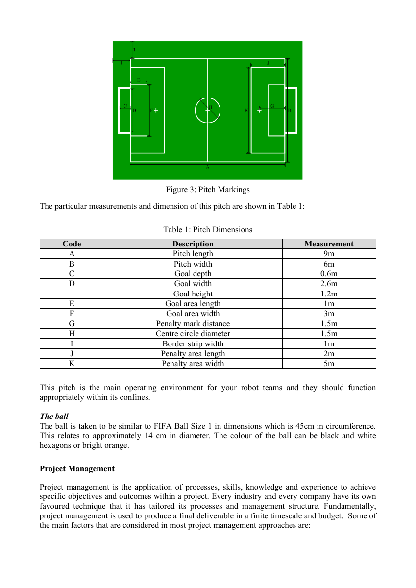

# 课程要求、证据与待决定事项

课程原始文件在 reference/course，SHA-256 与原输入相同；发生冲突时以 PDF 原文为准。提取 JSON 只是索引，里面的 null 不代表零。场地原文配图由 `scripts/render_course.sh` 生成。

| 课程要求/依据 | 当前实现 | 证据 | 未完成/适用边界 |
|---|---|---|---|
| 两队、每队 4 台 NAO6 | 二维 4v4；每机器人一个共享库实例 | 阶段 3 40 场日志 | 二维圆形代理不是 NAO6 动力学 |
| 场地 9×6 m、净门宽 2.6 m、门高 1.2 m 等 | 中心坐标、课程尺寸配置；二维无高度；小组世界尺寸已由脚本核对 | 课程 PDF 第 3 页、生成参数表；M2 场地脚本 | 阶段5已核对；参考模型为V5 |
| 自主足球行为 | A 的角色、接近、绕球、射门/传球逻辑 | 算法等价与实际比赛 | 理想全场观测/集中协调是否允许待确认 |
| 建立经过验证的仿真再部署实机并修正差异 | 软件迁移回归、确定性和接口时序验证 | 全阶段 evidence | 物理参数校准、实机试验尚无数据 |
| 推荐 MATLAB 等工具，也可讨论其他工具 | MATLAB/Simulink/Stateflow；M2 ROS 2/Webots 路线 | 构建脚本、模型 | 课程没有强制必须用 Stateflow/ROS 2/Webots |
| 球约 14 cm | 二维半径 0.07 m，标近似来源 | 参数表与原文 | 球质量仍未知；三维显式采用0.15 kg教学假设，待实测 |
| 按课程规定声明 AI 使用 | AI_PROVENANCE 列明生成内容和验证职责 | docs/AI_PROVENANCE.md | 组员应按最新课程政策填写自己的声明并理解代码 |

来源类别不能合并：课程要求来自课程 PDF；RoboCup 2025 是参考规则、采用范围待确认；现有行为来自 A/B 源码；ControllerCore/requestId 是本次工程设计；准备时间、搜索转速、Tap 速度等是教学设定；未知物理量保持待确认。完整当前值与类别见 generated/parameters.md，原始 null 路径见 generated/unknown_parameters.json。

交给小组/导师的决定清单：

1. 课程采用 Physical、Virtual 还是简化规则？哪些重开、犯规、间接球条款进入本阶段验收？
2. 是否允许全局理想观测、集中角色分配、GPS/Supervisor 教学真值？若不允许，定位与团队通信如何验收？
3. 二维能作为算法验证证据到什么程度？V5 Webots 模型能承担哪一部分研究，何时必须迁移 NAO6 或测实机？
4. 请给出需达到的成功率、进球/防守指标、时延与鲁棒性指标，及可用实测数据；当前速度/减速度不可当已知硬件上限。
5. 是否在后续任务授权安装 ROS Toolbox、Simulink Coder、MATLAB Coder？本次 ALLOW_INSTALL=否，保持阻塞。
6. 确定实际球质量、球/草地摩擦、相机外参、传感延迟和动作执行时间；不要把空值填 0。

阶段 5 只做到单机器人。多机器人后续需要：独立节点/命名空间、唯一时钟、每机器人请求会话身份、团队消息年龄、异步动作仲裁、相机/定位、规则与物理参数标定。不能把复制八个 NAO 节点等同于已经得到可靠 4v4 三维比赛。

## M2更新与仍待导师决定的问题

ROS标准消息通信和代理中的原Core在线回放已通过；缺产品的原生在线块、Read Image和生成独立节点仍BLOCKED。Webots单V5已完成实际接近/物理踢球，定位为只读Supervisor真值，感知算法和NAO6动力学尚未验证。新增需要确认：课程是否接受此阶段V5替代及真值定位；球质量/接触/运动速度应采用哪组实测；是否今后授权安装三产品；完整比赛重开规则采用哪个rulesProfile。未安装不是许可失效，不申请本轮额外安装。

## 球队 V1 增量验收

固定角色、主追球人、半场分工和故障时 MF 接管来自球队 V1 工作表。中线滞回半宽、失效采集时刻的处理、开球同位处理与显式恢复信号由本项目选择。小组需要确定前锋恢复应由什么可测信号触发，以及如何用交换先开球队的实验评价攻防平衡。球队表格与课程文件在手册中分开标注。各条原始单元格、实现和验证场景见[球队 V1 对照表](tactics_v1_design.md#4-单元格怎样落实为验收门)。
