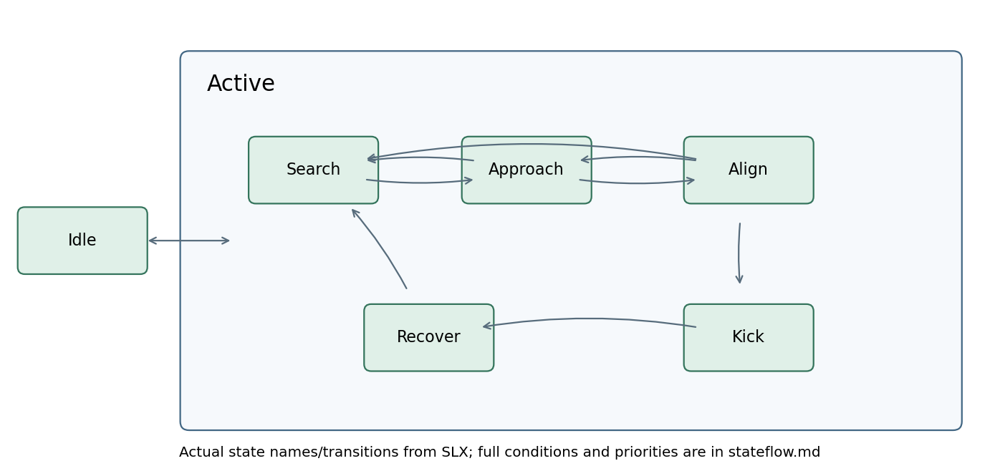
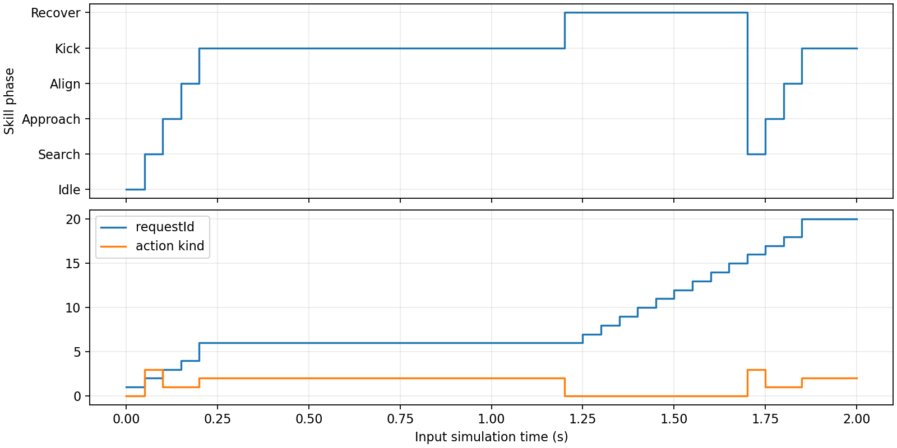

# 一次踢球为什么需要状态图

具体问题：发出踢球请求后，下一拍球还在脚边。若每拍都重启动作，机器人永远做不完准备阶段。Stateflow 的作用是记住“当前在等待编号多少的动作”，并在完成、失败、超时或停赛时离开等待。

状态是持续一段时间的工作阶段，转换是从一个阶段切到另一个阶段的条件。`en:` 表示进入状态时执行一次；`du:` 表示后续采样仍处于状态时执行；`en,du:` 两种时机都执行。方括号内是布尔条件，斜杠后是转换动作。层级状态 Active 包含五个子状态，因此停赛时从 Active 到 Idle 的父级转换可以统一退出所有技能阶段。

完整状态文字和转换由生成后模型的 XML 导出，见 [stateflow.md](../generated/stateflow.md)；机器可读版为 [stateflow.json](../generated/stateflow.json)。这里的文字与图片都不应手改，应修改 `scripts/build_controller.m` 再运行导出脚本。所有计时采用输入 tSim 差值，避免 Stateflow 时间计数与 Webots 时钟不一致。

| 层级/状态 | 进入后的职责 | 默认后续 |
|---|---|---|
| Idle | phase=Idle；不可信自身观测或停赛时保持停止（compat 另有等价路径） | 自身有效且允许比赛后到 Active |
| Active | 对子状态共同管理请求编号更新 | 默认进入 Search |
| Search | phase=Search；delayed 中按 searchTurnRate 旋转 | 有球或 Goto 意图时 Approach |
| Approach | phase=Approach；执行几何接近速度 | 距离进入阈值后 Align |
| Align | phase=Align；满足位置、朝向和冷却条件 | 进入 Kick |
| Kick | 锁定目标、速度、编号、kickStart | 同编号结束反馈 / 超时 / 失球后 Recover |
| Recover | 保存 recoverStart；停止平移 | 等 recoverTime 后 Search |

Align 的进入阈值默认 0.35 m，退出阈值 0.45 m。这是滞回：两个阈值之间保持阶段，避免距离测量在边界附近抖动。踢球本身仍需 kickRange、kickAlign、behindTol 和冷却满足，不能用 Align 阈值代替踢球条件。

转换优先级必须结合生成表阅读。父级 Active→Idle 先处理自身失效/停赛；Approach 和 Align 的失球转换优先于一般接近；Kick 中同编号终态反馈优先于超时，超时优先于失球；Recover 到时才重新搜索。同一采样时刻满足多个条件时，只走优先级最高的可用转换。

用 `P=tdp.defaultConfig();P.mode=TdpMode.Delayed;s=makeScenario(P,2);records=runReplay(P,s);` 手走一次。场景中机器人在 (-0.25,0)，球在 (0,0)，目标 (4.5,0)，初始朝向 0。不注入反馈，因此应经历 Idle→Search→Approach→Align→Kick→Recover。每拍的精确编号和时刻见脚本生成的周期表；不能先猜 requestId 为 1，因为 Idle/Active 和 Kick 的进入动作都会影响编号。

`test_controller/testLateFeedbackIgnored` 先运行一次取得实际 Kick 编号，再注入错误编号 Done；期望仍停留 Kick。这个测试的变异版删除编号比较，测试确实失败，说明它不只是检查“没有报错”。`test_controller/testNormalFeedback` 同时检查 0.05 与 0.04 s 下的匹配 Done 路径。

实际建图遇到过一个隐蔽问题：脚本创建的转换曲线中点超出了 Active 边界，Stateflow 将它解释为跨层级退出再进入，编号被反复改变。修复是把转换中点和父状态边界同时放对，保留层级诊断。初学者手工拖动图后也应检查模型警告，而不是仅看箭头两端的文字。
