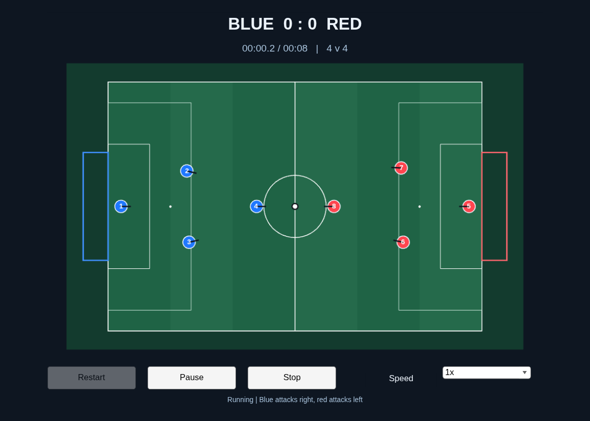
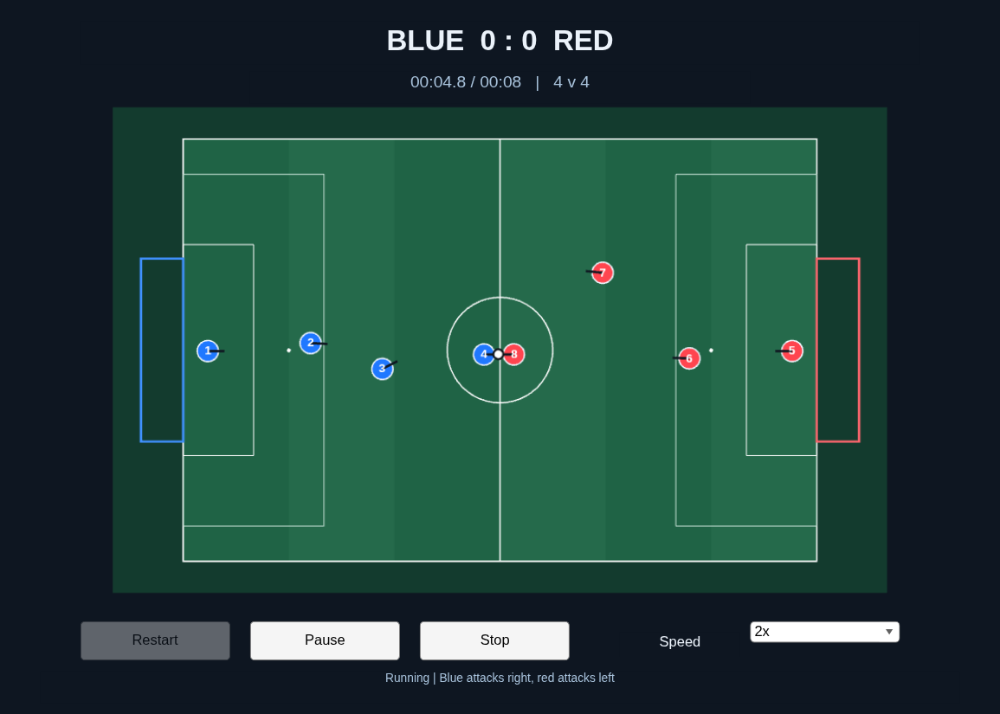

# 实际动画验证数值

本页由 `scripts/export_animation_manual.py` 从通过的私有显示回执生成。

来源：`evidence/animation/display-02/artifacts/receipt.json`。窗口真实渲染于任务独占的虚拟显示；未操作用户桌面。

| 项目 | 实测值 |
|---|---:|
| testsPassed | 4 |
| pausedSimulationTime | 0.35 |
| frozenSimulationTime | 0.35 |
| stoppedFrames | 97 |
| restartFrames | 160 |
| launcherFrames | 100 |
| coldInitializationSeconds | 148.777606 |
| launcherElapsedSeconds | 193.168737674001 |

最后三项来自实跑 `./start_2d.sh` 的单独冷启动；总墙钟包括 MATLAB 启动、编译、Max 比赛和关闭，不是实时倍率或启动时长保证。

前后两帧来自同一次逐步运行；暂停、倍速和停止不改变未加动画的轨迹前缀。

