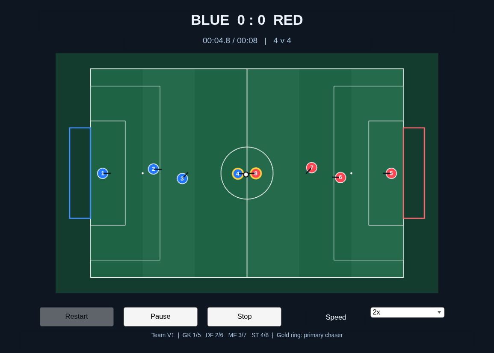

# 球队 V1 二维整场验收

独立 MATLAB 进程在提交 `ca87cb149cf7` 的全新本地克隆中从空白重建控制器和八机器人模型。25 项战术、模型与指标测试通过。MATLAB 内重建、测试、比赛及额外回放合计耗时 818.7 秒（13.6 分钟）。

双方均用同一 V1 策略，各队共四人。每场 600 仿真秒，蓝队攻 +x。下表双数的顺序均为蓝 / 红。“有进球场数”指双方至少一方得分的场次。“射门”按实际执行且达到射门速度的踢球计数。

| 周期 ms | 场数 | 采样步 | 进球 | 有进球场数 | 射门 | 实际踢球 | 其中 MF 射门 | 不同物理轨迹 |
|---:|---:|---:|---:|---:|---:|---:|---:|---:|
| 50 | 20 | 240,000 | 3 / 7 | 4 | 955 / 817 | 1,801 / 1,672 | 782 / 796 | 20 |
| 40 | 20 | 300,000 | 5 / 7 | 8 | 1,223 / 510 | 1,999 / 1,255 | 771 / 441 | 20 |

| 周期 ms | 首次触球范围 s | 无触球场数 | 中场接管累计 s | 接管时间占各队比赛时间 | 重叠步数 | 机器人越比赛线采样 | 机器人越外缓冲界采样 | 完全受阻平移请求 |
|---:|---:|---:|---:|---:|---:|---:|---:|---:|
| 50 | 3.95–3.95 | 0 | 6,629.90 / 6,249.55 | 55.25% / 52.08% | 0 | 24,297 | 0 | 2,567 / 1,377,478（0.186%） |
| 40 | 3.92–3.92 | 0 | 7,031.36 / 4,864.12 | 58.59% / 40.53% | 0 | 23,427 | 0 | 4,078 / 1,737,471（0.235%） |

越线以机器人外缘为准，逐机器人逐拍计数。重叠按两身体穿透超过 10⁻⁸ m 计步。完全受阻指请求了平移、该拍实际位移仍小于等于 10⁻¹⁰ m。每场的进球、请求与反馈编号、实际踢球者、几何指标和轨迹哈希可从汇总回执追溯。

两个周期各对种子 1 额外重放完整 600 秒，物理轨迹和战术日志分别逐元素相同。40 场共 540,000 步，均通过固定角色、单一追球授权、踢球时效、动作编号去重和实际射门计数核对。实际踢球与同拍球位移共同出现的次数在 50 ms、40 ms 下分别为 3,473 和 3,254。

故障后中场保留 MF 身份。默认比赛关闭人工恢复窗口，因此一次匹配的 ST 执行失败可以让中场持续接管到终场。定向实验另外验证了收到显式恢复后的撤权与交接。[真实交接时间线](v1_model_events.md)

图形入口在独立显示器上运行了 100 帧，首次编译与初始化耗时 120.2 秒。八台机器人全部移动，球累计移动 0.158 m，发生 2 次实际踢球。窗口响应关窗并正常退出。旧 ACompat 另跑了 40 场，同 A 的进球、射门、首次触球全部一致。零踢球噪声最大逐元素误差为 5.153e-14。默认噪声的轨迹分歧按场保存。

下图是 V1 窗口继续比赛后的实际画面。两队各自的金圈跟随追球授权。点击暂停后，引擎在第 7 帧确认暂停；间隔 0.430 墙钟秒再次取样，引擎时刻仍为 0.35 仿真秒。继续到第 95 帧时，引擎已恢复运行。该段全部物理采样与无动画比赛逐元素一致。

50 ms、种子 1 打成 0∶0，蓝队 109 次射门在下一次踢球前首次接触的对手均为红队 6 号后卫。球从射点到这次接触的中位位移为 0.366 m，中位用时 0.20 s。此处逐次检查仅覆盖这一场。

本组实验覆盖同策略、既定开球与初始站位下的二维比赛。更换开球、互换场向、引入其它对手或上三维平台，需要分别设计实验。二维射门速度和滚动减速度沿用现有参数，实机得分率和接触动力学仍待测。
