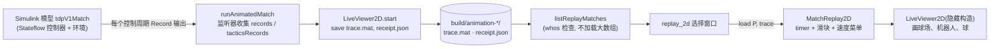
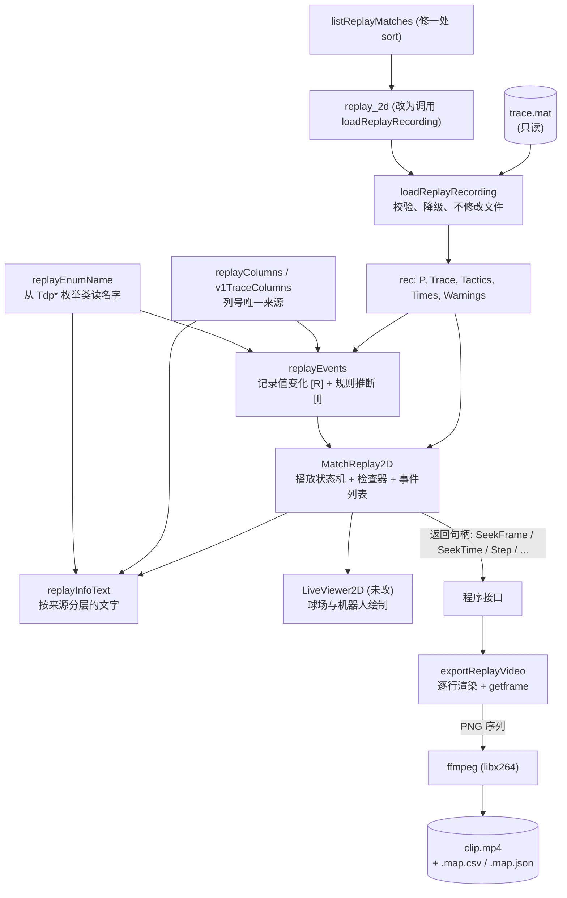
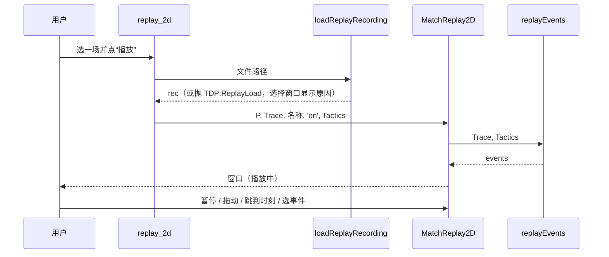
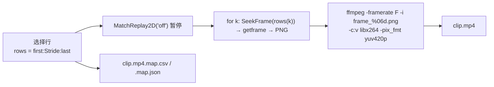

# 回放系统架构

## 1. 原有结构（修改前，提交 68276f3）



- `MatchReplay2D` 只读 `P` 和 `trace`（98 列），所以**战术日志已经保存却从未显示**。
- 它借用 `LiveViewer2D` 画球场，再把 Start/Pause/Stop/Speed 控件改成回放用途。
- 没有事件、没有单帧步进、没有按时刻跳转、没有视频导出。

## 2. 修改后的结构



## 3. 模块与职责

| 文件 | 职责 | 不负责 |
|---|---|---|
| `scripts/loadReplayRecording.m` | 打开 `trace.mat`，校验 `P`/`trace`/`tactics`，返回统一结构；坏文件抛 `TDP:ReplayLoad`；`tactics` 不一致时降级并给警告 | 任何写操作 |
| `scripts/replayColumns.m` | 98 列的列号表（与 `MatchRecord.m` 同序） | 战术列（那是 `v1TraceColumns`） |
| `scripts/replayEnumName.m` | 把记录里的数值翻译成 `Tdp*` 枚举成员名；未知值返回数字文本 | 保存第二份枚举表 |
| `scripts/replayEvents.m` | 从 `trace`/`tactics` 检测变化，生成带 `source`、`evidence` 的事件结构数组 | 解释原因；重新仿真 |
| `scripts/replayInfoText.m` | 某一行的检查器文字，分“记录/决策/请求/反馈”四组 | 绘图 |
| `environment/MatchReplay2D.m` | 播放状态机、时间轴滑块、检查器与事件列表控件、键盘、返回程序句柄 | 球场绘制（交给 `LiveViewer2D`）；文件读取 |
| `scripts/exportReplayVideo.m` | 选行、逐行驱动 `MatchReplay2D`、`getframe`、调用 ffmpeg、写对照表 | 播放节奏（按行号渲染，不看墙钟） |
| `scripts/listReplayMatches.m`、`replay_2d.m` | 列出/选择比赛；`replay_2d` 改为通过 `loadReplayRecording` 载入并传入 `tactics` | — |

## 4. 数据流



数据只向一个方向流动：文件 → `rec` → 窗口。窗口没有任何路径回写 `trace`、`tactics` 或文件（`testPlayerNeverModifiesItsInputs`、`testLoadingAndReplayLeaveRecordingsByteIdentical`）。

## 5. 播放状态管理

`MatchReplay2D` 的全部状态是几个闭包变量：

| 变量 | 含义 |
|---|---|
| `frame` | 当前显示的记录行 |
| `rate` | 速度倍率 ∈ {0.25, 0.5, 1, 2, 4, 8} |
| `anchorTime` | 锚定的**仿真**时间 a |
| `wall` | 锚定时刻的墙钟（`tic`） |
| `clock` | 周期 0.04 s 的 `timer`，运行即“播放中” |

播放时刻与显示行：

```text
t_play(τ) = min( t_end , a + r · (τ − τ0) )          τ0 = wall 起点，r = rate
frame     = max { k : times(k) ≤ t_play }
```

四个操作都只是改变 (a, τ0, r)，保证时间连续：

| 操作 | 动作 |
|---|---|
| 暂停 | `a ← t_play(now)`，显示该行，停止 timer |
| 继续 | `τ0 ← now`，启动 timer（`a` 保持） |
| 换速 | 若在播放：`a ← t_play(now)`、`τ0 ← now`；再改 `r` |
| 跳转 | 显示目标行，`a ← times(frame)`、`τ0 ← now`；若原先在播放则继续 |

时间由墙钟驱动，所以慢机器上会**丢帧而不是变慢**；单帧步进与导出按行号工作，不受此影响。

## 6. 时间线与事件处理

- 事件在窗口创建时由 `replayEvents` 一次性算好（600 s 记录 701 个事件，约 0.2 s），之后只做查表。
- 列表选中项始终是“行号 ≤ 当前行的最后一个事件”；点选或 `[` `]` 调用 `JumpToEvent`，它先暂停再显示该行。
- 事件的 `source` 字段区分 `recorded` 与 `inferred`，列表前缀 `[R]`/`[I]`，`evidence` 字段写明依据的列。

## 7. 视频导出架构



要点：画面来自**真实的回放窗口**（所以包含检查器）；渲染按行号进行，与墙钟无关；PNG 帧放在 `tempname` 目录并在结束时删除；ffmpeg 失败时抛 `TDP:ReplayExport`，不留半成品视频。

## 8. 设计决定与取舍

| 决定 | 备选 | 理由与代价 |
|---|---|---|
| 不改 `LiveViewer2D`，只在 `MatchReplay2D` 里移动其控件并添加新控件 | 改 `LiveViewer2D` 增加检查器 | 该类同时服务实时仿真，改动会碰到已有动画测试。代价：靠控件 `String`/位置属性调整布局，较“碰巧” |
| 事件由单独函数从矩阵计算 | 在仿真里新增事件日志 | **不改仿真输出格式**（约束）；代价：只能得到“字段变了”，没有原因 |
| 只有一种推断事件（追球者不动） | 更多规则（“前锋在等待”） | 推断越多越容易被误读成记录；其他分析留在回放之外并标明 |
| 导出用 `getframe` + PNG + ffmpeg | `VideoWriter('MPEG-4')`；`print`；屏幕录制 | 本机 `VideoWriter` 没有 MPEG-4 档（只有 Archival、Motion JPEG 2000、Motion JPEG AVI 等）；`print` 拒绝含 UI 控件的图窗；屏幕录制会带入无关窗口。代价：约 1.3 s/帧 |
| 导出按行号渲染 | 实时录屏回放 | 可复现，视频时间与仿真时间有精确对照；代价：不能顺便测回放流畅度 |
| `tactics` 不一致时降级而不是拒绝 | 直接报错 | 位置信息仍有价值；用 `Warnings` 明示 |
| `seekTime` 加 1 µs 容差 | 精确比较 | `166.6` 会因浮点误差落到前一行（回归测试 `testSeekFrameAndTimeSnapToRecordedRows`） |
| 显示前先 `drawnow` 再开始计时 | 保持原顺序 | 否则第一次绘制耗时（本机约 5 s）被计入播放时间，回放起点被跳过 |
